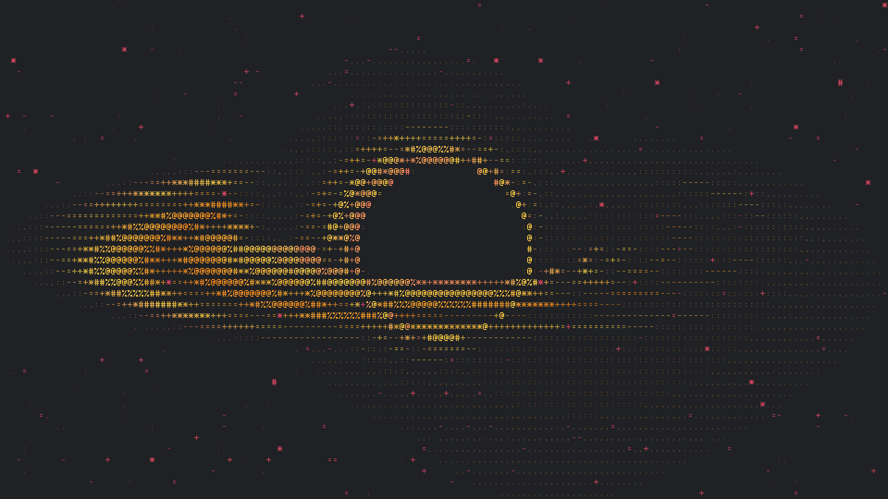

```
 ____  _____ ____ _____
|  _ \| ____/ ___|_   _|     descanso de tela ASCII para o terminal
| |_) |  _| \___ \ | |       buraco negro · galáxia · donut · fogo · túnel · e as suas próprias artes
|  _ <| |___ ___) || |       gradientes em 24 bits · protetor de tela · wallpaper · lockscreen
|_| \_\_____|____/ |_|
```

**Rest** transforma o terminal num descanso de tela ASCII: um **buraco negro** com disco de acreção, lente gravitacional,
anel de fóton e efeito Doppler, mais outras artes, tudo com o **gradiente de cores do seu tema** em cascata.
Uma interface em painéis, com terminal integrado `>_`, deixa você trocar artes, cores e parâmetros ao vivo, criar
descansos próprios e importar artes prontas. Não precisa instalar nada além do Python (**zero dependências**).



## Sumário

[Destaques](#destaques) · [Início rápido](#início-rápido) · [Galeria](#galeria) · [A interface](#a-interface) ·
[Comandos](#comandos-do-terminal-_) · [Temas e cores](#temas-e-cores) · [Criar um descanso novo](#criar-um-descanso-novo) ·
[Subir arquivos já feitos](#subir-arquivos-já-feitos) · [Configuração](#configuração) ·
[Wallpaper e lockscreen](#wallpaper-e-lockscreen) · [Protetor de tela](#protetor-de-tela) ·
[Problemas comuns](#problemas-comuns) · [Desenvolvimento](#desenvolvimento) · [Atualizações](#atualizações)

## Destaques

* **9 artes nativas** e suporte a artes suas (`.txt` com animação, ou plugins `.py`).
* **Tema em gradiente**: de 1 a quantas cores quiser na arte; a interface usa até 3 das mais predominantes.
* **Terminal integrado `>_`** com comandos para tudo; as preferências são salvas sozinhas num JSON editável (recarrega ao vivo).
* **Interface responsiva**: se adapta da tela cheia até janelas minúsculas.
* **Protetor de tela** em tela cheia com relógio opcional e playlist de artes.
* **Wallpaper e lockscreen**: exporta o quadro como PNG e aplica no Windows e no Linux.
* **Zero dependências**, binário único para Windows (`Rest.exe`) e Linux.

## Início rápido

**Requisitos:** Python 3.9+ (ou o `Rest.exe` pronto), um terminal moderno com **cores 24 bits**
(Windows Terminal, GNOME Terminal, kitty, Alacritty...) e uma fonte monoespaçada (Cascadia Mono, JetBrains Mono...).

```bash
python -m rest                       # abre a interface
python -m rest saver                 # tela cheia; Esc (ou qualquer tecla 2 vezes) sai
python -m rest saver --art galaxy
python -m rest doctor                # confere terminal, cores e tela cheia
python -m rest do import arte.txt    # roda um comando do terminal >_ sem abrir a interface
```

| Tecla | Ação | Tecla | Ação |
|---|---|---|---|
| `>` `/` `:` Enter | focar o terminal `>_` | `s` | **protetor de tela em tela cheia** |
| `Esc` | sair do terminal | `espaço` | pausar |
| `j` / `k` | trocar de arte | `+` / `-` | velocidade |
| `c` | próximo tema | `?` | ajuda |
| `PgUp` / `PgDn` | rolar a saída do terminal | `q` | sair |

**Executável:** `build_exe.bat` (Windows) ou `./build_exe.sh` (Linux) abrem o **instalador**, que mostra o banner REST e uma
barra de progresso em gradiente (laranja → rosa → roxo) enquanto instala o PyInstaller, roda os testes e gera
`dist\Rest.exe` (ou `dist/rest`). O log completo fica em `build.log`. Falhas nos testes viram aviso e não impedem a compilação. Opções: `--skip-tests`, `--strict-tests` (exige testes), `--dry-run` (só simula), `--no-color`.

```
  ✓ [1/5] Verificando o Python       0s
  ✓ [2/5] Instalando o PyInstaller   14s
  ✓ [3/5] Rodando os testes          6s
  ▸ [4/5] Compilando o executavel    ████████████████████░░░░░░░░░░░░░░░░░░░░░░░░  62%  00:41
```

No GitHub, o workflow `.github/workflows/build.yml` compila os dois a cada push e publica numa Release ao criar uma tag `v*`.

## Galeria

Capturas reais (sem cor) geradas pelo próprio Rest com a rampa `classic`. Na tela, tudo ganha o gradiente do seu tema.

**blackhole**
```
:                                      =                                    -
                                    -                                        +
                     -                      *                    =       .
          -      .                ..-   *
                . =     :  .......::::...........
       -                .....:::::-+-----::........     -          .   +
               =      ....::::::::+----::----:......    .................
  .         .       ........:--*#%@@@@@@@#=:---..............................
               ...........-:=*%#*#@        @+:--:.............................
       ..::-=+*###*+=-:..:-+#*+@@            #:--........::--::::::...........
   .:-+*#@@@@@@%#+=-:...:-+*+*@-              ---:..::::::::----::::::::.=....
 .:=+#%%%#**++*#%@@#+-..:=+=+@@                @=:::::::::::---:::::::::::=...
 .:=++*+++++*#@@@@@@%#@@@@#+-%@                @:::++-:--===-::::::::::+::+...
  ..::--===+*#%@@@@@@#**%@@@@@%%@@@@#+----==++*####*+=--::*::::------::::::...
       ...::-=+*#%%@@@@%#*++=+**@%@@@@@@%%%##*****+++++====----::::::::::::...
               ...:--=+**######***@===-----@:::::::::::::::::::::::::::::.....
                        .....=:-=-:-+**+==--:::::::::::::::::::::::::::.......
                         ...+...:---::..........::::::::::::::::::::..........
             .     :      ..........:-::........=..:::::::::::::.............=
                            ....  : =....................-................  :
                     =:  -                ............................
            -  .:    =                       .=.........-......=...
                               +       =       :...........:..
                              -                  *
```

**galaxy**
```
-    *  .     ..:----:..           ..:::-----------::*:...                  :
             ..:----:..         ..:-=========--======----::...
            ..::---:..        .:-====--::........:::--------::...
      -     .::---:..       .:-===-:.               ...::-----::...
           ..:----:.      -.-=+=:.            :         ..::----::...
           ..:---:..      .-++-.-    ..------::..         ..::----::..
::  .      ..:---:.      .-++-.   +:+**+==-==+++=-:. .........+:---::...
           ..:---:.      :=+=.   :+#=:..=...  .:-++=-...........:----::..-..
           ..:---:.      :=+-   :#*::-*@@@#=:.....-++=:..........::---::......
            .:----:.     :++-  -+%-=@@**++==##-....:=+=:..........::--::......
.           .:--=-:=     .=+-. .+%=+@%%@%%@=:=#-....:=+=:::::::*::.::--::.....
..           .:-==-:.     :++-:.:#%+#@@@@*%#::+*:...::==-::::::::::::--:::....
..      +    ..:-==-:.    .:+*-..:=@@@@@*+@+:.=*-.::::-==:::::::::::::--::....
...         : ..:-==-:.     .-+*=::::---*@+...+*:.::::-==::::::::+:.:::-:::...
:...=           .:-===-..     .:-+*####*#....=*=...:::-==::::::::....:::::+...
:::...          :..:-===-:.            ....:++-......:==-:::.........::::::..
::::...            ..:-====-:..        .:-++=:......:*==-:...........::::::..
::::::... -          ..::-=======+--==++++-:........-==-:.....:......::::::..
::::::::...         :    ..::---=====--:..  ......:-==-:.............::::::..-
..::::::::...      .           .....           ..:-==-+.........  ..::::::...
....::::::::.... .                           ..:--=--:....        ..::::::...
 .....:::-::::::....                      ..::--=--:..      :-  =..::::::...
```

**donut**
```
     *                                 .             *
                :           @@@@@@@@@@@   -
                        @@@@@%%%%@@@@@@@@@@
                    =@@%%##########%%%@@@@@@@
         - :       %%%%####********###%%@@@@@@@
                  %%%###*++======++**###%@@@@@@@............
       :         %%%###*==-:.  ..:-=+**##%@@@@@@%..:........
  :       +     %%%%##*+=-.       .-=+*#%%%%@@@@%#..........
               #%%%%%#*+=:      =..:=+*##%%%%%%%%#+:::::::..
               #%%@@%%#*=-     ....-+**##%%%%%%%%#*:::::::::
               #%%@@@@%%#+   ......+**##%%%%%%%%##*:::::::::
               *%%@@@@@@@%* .....=**##%%%%%%%%%###+::::+::::
               *#%@@@@@@@@@@%%###%%%%%%%%%%%%%###*::::::::::
             - +##%@@@@@@@@@@@@@@%%%%%%%%%%%####++:::-::::.+
                +##%%@@@@@@@@@@@@@%%%%%%%%####*++::::::.....
                 +*##%%@@@@@@@@@%%%%%%######**+=::..+.......
  .     -         =+*#%##%%%%%%%%###%#*##**++=:...........
=           - :    :=+**####%####*###****++=-.......*..
                      -==++********+*++=--.........
          .              .:----===---::
```

**warp**
```
               #  =        :    :            =               : #      %
                    :*                      :++             =     +
                        =               +   --           :    :
                          :             -= =.     +   *
                                 = =    = -     - . -                     +
                                  :--   :.     .                     :
                         +  - =:   .::::    -
                             ==::. -...:  .:                         +    %
      %   +  #   = *: -  .   = : .  :..:.:       .  - +          ::  +   %
                               .  . :..:. .  . :                          :
                           = - -.--::.:: : :- . -= = +              :   +   %
                           .-=.    .- :-:::-  .          :      :   +   %
                     *  -+   .   =:   - - - : = - +         =    :
                      : +: -    .-  .=     -        -  *  :    #     +
       +   :       =:  =        =  -        -                =           %
   %         :  #=  *         -    +        ++ :                 #
         +    #              +
      %                                       =  = :
```

**fire**
```


............  ............................ ...................   .............
.....::::::...............::::::......:........::::::....::::.......::::::..::
::::::------::..:::::::..:::-----::::::::::....::----::::::--::.....::---:::::
---:::--====--:::::---:::::--====--:::----:::..::-====---------::...::--=-----
===----==++++=-::::------::-==++++=--:-------:::--=++++=----===--:::::-==++==-
=++++====++**+=-:::--=====-==++***+=--:--====----=++***+==---====--::--=+***+=
+**#**+++++***+=-:::-=+***+++++**#*+=-::--=++++===+*###*+=----==++==--=+*####*
+*#%%%#*+==++*++=---=+*#%%#**+++****+=-:--=*###**++**###*+=-:--=+***++++*#%%%#
*#%@@@%#+====+***+===+*%@@@%#*+++****+=--=+*%@@%%#****###*+=---=*#%%%#***##%%#
*#%%@@@%*+=-=+*####***#%@@@@%*+==++*#**++++*%@@@@%#*++**##*+===+*%@@@@%#**##%%
%##%@@@@#*=--=+#%@@%###%@@@@@%*+==+*#%%#***#%@@@@@%#+++**###*+++*%@@@@@%#***#%
```

**tunnel**
```
==+++********++=--::::-=+**###**++==++****++==++*#%%@@@@%##**++====++++***####
--===++++++++==-::....:-=++++=-:::-+*#%@@%#*+=-==+*#%%%%##**+++==++++**####%%%
::---===++++==--:.   ..:====-:  .:-+***#**+=-:...:-=+****++=======++**###%%%@@
..:::--=======--:.. ..:=+*+=-:::=++=:. .:=+*+=:...:-==+==--::::--==++*##%%%@@@
....::--==++++==-::::-=*#%#*==*%@%*=+***+=+#@@#*===+**+=-:......:--=+**##%%%@@
 ...::--=++****++==-=+*%@@#+=+**-.-++--=+=..:=+=--+#%%%*+-:.   ..:-==+**##%%%%
 ...::--=+**#####*++=+*#%#=..-=::#*=##=: .==-*%*: .=#@@%*=-:....::-==++**#####
...:::-==+*#%%@%%#*+===++=: -##=*.=:*-++-+.=#.-#*-:-=*##*+=---:----==++++*****
:::::--=++*#%@@@@%*+-:.:=+=-*%-:++.-:=::--..*.**:-**+=====+++++++=====++++++++
------==++*##%%%%#*=:. .=#%+-+-*:+:.-.::..====-%:.*@#=:..-=+*###***+++========
========+++***###*+=-..:=#@*.:%-====..::.-.:+:*-+-+%#=. .:=*#%%%%##*++==------
++++++++=====+++++++=====+**-:**.*..--::=:-.++:-%*-=+=:.:-+*%@@@@%#*++=--:::::
*****++++==----:---=+*##*=-:-*#-.#=.+-++-*:=.*=##- :=++===+*#%%@%%#*+==-:::...
#####**++==-::....:-=*%@@#=. :*%*-==. :=##=*#::=-..=#%#*+=++*#####**+=--::...
%%%%##**+==-:..   .:-+*%%%#+--=+=:..=+=--++-.-**+=+#@@%*+=-==++****++=--::...
@@%%%##**+=--:......:-=+**+===*#@@#+=+***+=*%@%*==*#%#*=-::::-==++++==--::....
@@@%%%##*++==--::::--==+==-:...:=+*+=:. .:=++=:::-=+*+=:.. ..:--=======--:::..
@@%%%###**++=======++****+=-:...:-=+**#***+-:.  :-====:..   .:--==++++===---::
%%%####**++++==+++**##%%%%#*+==-=+*#%@@%#*+-:::-=++++=-:....::-==++++++++===--
####***++++====++**##%@@@@%%#*++==++****++==++**###**+=-::::--=++********+++==
```

**plasma**
```
##****+++=======++++++*******************++++++++++++++++***
####***++++++++++++*******###############*****++++++++++****
%%###***+++++++++*******###################****+++++++++****
%%###***+++++++++********###################***+++++++++****
%###**+++++++++++++**********############*****+++++++++++***
##**+++========+++++++*********************+++++=======+++**
#**++==------=====++++++++******+++++++++++=============++**
*++==----------====++++++++++++++++===========------====+++*
++==--::::::---===+++++++++++++++========-----------====++**
++=---::::::--===+++********+++++=======-----------===+++***
++==---:::---===++****####*****++++=================+++****#
*++==-------==++***###########****+++++==========++++***####
**+++========++***###%%%%%%%####****+++++++++++++++***####%%
#***+++++=+++++**###%%%%%%%%%####*****++++++++++****###%%%%%
```

Ainda tem `matrix` (chuva de glifos que usa o seu tipo de texto) e `waves` (camadas de ondas).

## A interface

```
 ◆ REST  ascii screensaver · blackhole · ~/.config/rest
 ╭─ ◆ Artes ──────╮╭─ ≡ Preview · blackhole ───────────────────╮╭─ ◇ Parametros ───╮
 │▸ blackhole     ││                                           ││speed    1        │
 │  galaxy        ││            animação ao vivo               ││cascade  0.35     │
 │  meu-logo *    ││                                           ││─ blackhole       │
 ╰────────── 1/10 ╯│                                           ││tilt     0.24     │
 ╭─ ◈ Tema ───────╮╰───────────────────────────────────────────╯╰──────────────────╯
 │████████████████││>_ set tilt 0.3                            ││estado  rodando   │
 │◆ ██ #ff8c1a x5 ││ok blackhole.tilt = 0.3                    ││quadro  4.1 ms    │
 │◆ ██ #ffd54a x3 │╰───────────────────────────────────────────╯╰──────────────────╯
 ╰────────────────╯
 > terminal | j/k arte | c tema | s saver | espaco pausa | +/- velocidade | q sair
```

A interface **se adapta ao tamanho da janela** (redimensionar ou entrar em tela cheia atualiza na hora):

| Janela | Layout |
|---|---|
| 112+ colunas | 3 colunas: **Artes + Tema** · **Preview + Terminal** · **Parâmetros + Metadata** |
| 84 a 111 colunas | **Artes + Tema** · **Preview + Terminal** |
| 44 a 83 colunas | **Preview + Terminal** empilhados |
| menor que 44×12 | **modo compacto**: a arte ocupa a janela toda, com 1 ou 2 linhas para comandos |

A altura dos painéis de baixo e as dicas de teclas do rodapé também se ajustam ao espaço disponível.
A saída do terminal quebra linhas na largura do painel e rola com `PgUp`/`PgDn`.

## Comandos do terminal `>_`

| Grupo | Comandos |
|---|---|
| Artes | `art <nome>` · `arts` · `new <nome> [txt\|py]` · `import <arquivo> [nome]` · `rm <nome>` · `edit [arte]` |
| Cores | `colors #ff8c1a:5 #ffd54a:3 rosa` · `colors add\|rm\|set` · `bg #1f2124` · `theme <nome>` · `theme list\|save\|del` |
| Texto ASCII | `chars classic\|dense\|blocks\|dots\|binary\|braille\|stars\|hex` ou `chars " .oO@"` |
| Ajustes | `speed` · `fps` · `cascade` · `aspect` · `params` · `set <param> <valor>` (ex.: `set tilt 0.3`, `set stars off`, `set mode bounce`) |
| Protetor de tela | `saver` · `clock on\|off` · `playlist <a> <b> ...\|all\|clear` · `cycle <segundos>` · `scr install [min]\|uninstall` |
| Wallpaper | `wallpaper export [arq.png]\|set\|lock` |
| Sistema | `save` · `reload` · `reset` · `config` · `doctor` · `pause` · `clear` · `help [comando]` · `exit` |

Tudo é **salvo automaticamente**. Suas artes ficam na pasta `arts`, ao lado do arquivo de configuração.

## Temas e cores

Escolha com `theme <nome>`, com a tecla `c` ou monte o seu com `colors`. Todos os temas prontos têm fundo escuro.

| Tema | Cores (peso) | Fundo |
|---|---|---|
| `gargantua` | `#ff8c1a` `#ffd54a` `#ff4d6d` | `#1f2124` |
| `sunset` | `#ff5e62` `#ff9966` `#ffd194` | `#1d1b22` |
| `ice` | `#4dd0e1` `#4d8bff` `#e8f7ff` | `#14181f` |
| `matrix` | `#00ff5f` `#00b341` `#c8ffd9` | `#0b0f0c` |
| `vapor` | `#ff4de1` `#a06bff` `#4dd0e1` `#ffd54a` | `#17141f` |
| `mono` | `#e8e6e1` | `#1a1a1a` |
| `ember` | `#ff4500` `#ff8c00` `#ffd700` `#ffe9a8` | `#1b1512` |
| `aurora` | `#39ffb0` `#4d8bff` `#a06bff` | `#10151c` |
| `synthwave` | `#ff2e97` `#7b2ff7` `#00e5ff` | `#160f26` |
| `sakura` | `#ff9ebb` `#ffd1dc` `#c779d0` | `#1d1820` |
| `crimson` | `#e10a2d` `#ffffff` | `#1c1c1f` |
| `blush` | `#ff5c9a` `#ffffff` | `#1e1d20` |
| `rosewhip` | `#c8102e` `#ff4d8d` `#ffffff` | `#1b1a1d` |
| `ruby` | `#9b111e` `#e0115f` `#ffb3c6` `#ffffff` | `#1a181b` |
| `midnight` | `#4d8bff` `#ffffff` | `#14171c` |
| `gold` | `#ffc233` `#ffffff` | `#1a1a1a` |
| `lavender` | `#a06bff` `#ffffff` | `#1a1822` |
| `tangerine` | `#ff7a00` `#ffffff` | `#1d1a18` |
| `forest` | `#5bd67a` `#e8ffe8` `#2e8b57` | `#121714` |
| `ocean` | `#00b4d8` `#90e0ef` `#ffffff` | `#10161b` |
| `cyberpunk` | `#00e5ff` `#ff2e97` `#ffe600` | `#14111d` |

**Regra das cores da interface** (bordas e título do canto superior esquerdo): a interface usa as cores **mais predominantes**
do tema, em gradiente: 1 cor → 1, 2 → 2, **3 → 2, 4 → 3**, máximo 3. "Predominância" é o peso depois dos dois pontos
(`#ff8c1a:5`); sem pesos, vale a ordem da lista. A arte usa **todas** as cores que você definir, em gradiente com efeito
cascata (`cascade` controla a velocidade).

**Parâmetros do buraco negro:** `tilt` inclinação do disco · `spin` rotação · `zoom` · `doppler` assimetria de brilho ·
`ring` anel de fóton · `glow` halo · `inner`/`outer` raios do disco · `fill` estende o disco até as bordas ·
`stars`/`density` estrelas · `nebula` poeira de fundo. (`galaxy` e `donut` também têm `stars`, `density` e `nebula`.)

## Criar um descanso novo

### Opção 1: arte ASCII em 1 minuto (arquivo `.txt`)

1. Abra o Rest e aperte `>` para focar o terminal.
2. Digite `new meu-logo`. O Rest cria `arts/meu-logo.txt` com um desenho de exemplo, **seleciona a arte** e abre o arquivo no editor.
3. Cole ou desenhe a sua arte e **salve**. A tela atualiza sozinha.
4. Ajuste pelo terminal:

```
set mode bounce        center | bounce | scroll | wave | tile
set speed 2
colors #ff8c1a #ffd54a #ff4d6d
```

| `mode` | efeito |
|---|---|
| `center` | parada no meio |
| `bounce` | quica pelas bordas (estilo logo de DVD) |
| `scroll` | atravessa a tela da direita para a esquerda |
| `wave` | ondula |
| `tile` | repete pela tela inteira, rolando |

As cores vêm do seu tema com a cascata animada: não precisa colorir o texto.

**Animação com quadros:** separe os quadros com uma linha contendo só `---frame---` e use `set fps 6`.
Veja `examples/foguete.txt` (3 quadros).

### Opção 2: com código (arquivo `.py`)

```
new minha-onda py
```

Cria `arts/minha-onda.py` já funcionando (uma espiral). Edite `compute` e salve: recarrega ao vivo e, se der erro,
o Rest mostra a mensagem no terminal e continua rodando.

```python
from math import sin
from rest.arts import Art

class MinhaOnda(Art):
    name = "minha-onda"                     # minúsculas, números, - e _
    desc = "Minha onda"
    defaults = dict(speed=1.0)              # viram parâmetros: params / set speed 2
    ranges = dict(speed=(0.1, 5.0))         # limites aceitos

    def compute(self, w, h, t, p):          # w x h celulas, t = segundos, p = parametros
        br = [0.0] * (w * h)                # brilho 0..1  -> caractere da rampa de texto
        ph = [0.0] * (w * h)                # fase   0..1  -> cor no gradiente do tema
        for j in range(h):
            for i in range(w):
                k = j * w + i
                v = 0.5 + 0.5 * sin(i * 0.2 + j * 0.4 - t * p["speed"] * 3)
                br[k], ph[k] = v, i / w
        return br, ph, None                 # 3o item: lista de glifos fixos, ou None
```

A célula do terminal é ~2x mais alta que larga (`aspect` = 0.5) e a cascata de cor já anda sozinha (`cascade`).
Para letras fixas devolva uma lista de glifos no lugar de `None` (veja a arte `matrix`). Nos `.exe`, plugins podem usar
`math`, `random`, `time`, `colorsys`, `itertools`, `functools`, `string`, `statistics`, `datetime` e `json`.

## Subir arquivos já feitos

Já tem uma arte ASCII (de um site, do `figlet`, do seu editor...)? Traga para o Rest:

| Como | Exemplo |
|---|---|
| Pelo terminal `>_` | `import C:\Users\voce\Desktop\logo.txt` |
| Dando um nome | `import logo.txt meu-logo` |
| **Arrastando** o arquivo para a janela | digite `import ` e arraste o arquivo (o caminho é colado, com aspas) |
| Sem abrir a interface | `rest do import logo.txt meu-logo` |
| À mão | copie o `.txt`/`.py` para a pasta `arts` (o Rest percebe sozinho) |
| Exemplos do repositório | `import examples/foguete.txt` · `examples/saturno.txt` · `examples/rest-banner.txt` · `examples/espiral.py` |

* `.txt` → vira uma arte (estática ou animada com `---frame---`). `.py` → plugin.
* O nome vem do arquivo (minúsculas, sem espaços) ou do segundo argumento. Nomes das artes nativas são reservados.
* Reimportar com o mesmo nome **substitui** a arte. `rm nome` remove; `arts` mostra tudo e a pasta; `edit nome` abre o arquivo.
* Para **compartilhar**: coloque o arquivo numa pasta do seu repositório (como `examples/`) ou mande a pasta `arts` num zip.
* ⚠️ Um `.py` **executa código** na sua máquina. Importe só de fontes em que você confia.

## Configuração

O arquivo é criado no primeiro uso e pode ser editado à mão (o Rest recarrega ao salvar):

* Windows: `%APPDATA%\Rest\config.json` · Linux: `~/.config/rest/config.json` (ou o caminho em `$REST_CONFIG`).

```json
{
  "art": "blackhole",
  "colors": ["#ff8c1a:5", "#ffd54a:3", "#ff4d6d:1"],
  "background": "#1f2124",
  "charset": "classic",
  "speed": 1.0, "fps": 24, "cascade": 0.35, "aspect": 0.5,
  "saver": { "exit_on_mouse": false, "clock": false, "playlist": [], "cycle_seconds": 60 },
  "wallpaper": { "width": 1920, "height": 1080, "scale": 2, "time": 8.0 }
}
```

Os parâmetros de cada arte ficam em `params` (preenchidos no primeiro `save`). Um arquivo inválido nunca derruba o app:
o Rest avisa no terminal e usa os valores padrão.

## Wallpaper e lockscreen

```bash
rest wallpaper export -o wall.png --size 2560x1440 --art blackhole
rest wallpaper set       # aplica como wallpaper
rest wallpaper lock      # tela de bloqueio
```

Gera um PNG do quadro atual com glifos de verdade (só biblioteca padrão).

* **Windows**: `set` usa a API do sistema. `lock` tenta gravar `PersonalizationCSP` (precisa de administrador); sem permissão,
  abre *Configurações → Tela de bloqueio* para você escolher o PNG.
* **Linux**: GNOME (`gsettings`), KDE (`plasma-apply-wallpaperimage`/`kwriteconfig`), `feh`, `nitrogen`.
* Wallpaper **animado** no Linux: `xwinwrap -ni -fs -s -st -sp -b -nf -- kitty --class rest -e rest saver`.
  No Windows não existe wallpaper de terminal animado nativo; use o PNG ou o protetor de tela.

## Protetor de tela

* **`s`** (ou o comando `saver`) entra em **tela cheia de verdade** (Alt+Enter no Windows; `wmctrl` no X11) e a arte ocupa a tela inteira.
  **Esc** sai na hora; qualquer outra tecla precisa ser apertada **2 vezes**. Mexer o mouse só sai se `saver.exit_on_mouse` for `true`.
  Ao sair, a tela cheia é desfeita.
* **Playlist:** `playlist blackhole galaxy fire` + `cycle 45` e o protetor troca de arte a cada 45 s.
* **Relógio:** `clock on` mostra HH:MM grande no canto inferior direito (os dois pontos piscam), com as cores do tema.
* **Windows** (experimental): `Rest.exe scr install 5` copia o exe como `Rest.scr` e registra em HKCU.
* **Linux**: `xset s 300 && xss-lock -- xterm -fullscreen -e rest saver` (ou `swayidle`).

## Problemas comuns

| Sintoma | O que fazer |
|---|---|
| Faixa preta ou arte não cobre a lateral em tela cheia | Rode `rest doctor` e confira "janela do terminal". O Rest lê o tamanho real da janela e ignora `COLUMNS`/`LINES` velhos |
| Não sei se meu terminal serve | `rest doctor` mostra tamanho real, cores 24 bits, tela cheia e pastas |
| Arte "esticada" ou achatada | Ajuste `aspect` (ex.: `aspect 0.45`) conforme a fonte do terminal |
| Cores sem gradiente | O terminal precisa de cores 24 bits (Windows Terminal, não o `cmd` antigo) |
| Janela pequena demais para os painéis | Abaixo de 44×12 o Rest entra no modo compacto; aumente a janela para ver a interface completa |
| `S` não entra em tela cheia no Linux | Instale `wmctrl` e `xprop`, ou aperte F11 antes |
| Plugin `.py` não aparece | Veja a mensagem em vermelho no terminal `>_`: o erro aparece lá |

## Desenvolvimento

```bash
python -m unittest discover -s tests -v
```

```
rest/arts.py       artes (buraco negro, galáxia, donut, ...) + Backdrop + TextArt
rest/userarts.py   artes do usuário (.txt e .py), templates, import/rm
rest/engine.py     brilho/fase -> caractere + cor (ANSI e PNG) + relógio
rest/app.py        interface responsiva e protetor de tela em tela cheia
rest/commands.py   terminal >_
rest/export.py     PNG (wallpaper/lockscreen)       rest/system.py   integração com o SO e doctor
installer.py      instalador (banner + barra de progresso); build_exe.bat/.sh só chamam ele
examples/          artes prontas para importar
```

Novas artes nativas: crie uma classe em `rest/arts.py` (`defaults`, `ranges`, `compute(w,h,t,p)` devolvendo
`(brilho, fase, glifos|None)`) e registre em `ARTS`.

## Atualizações

[CHANGELOG.md](CHANGELOG.md)
